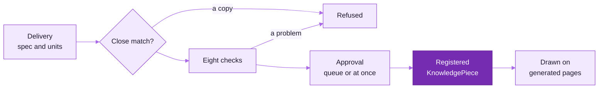

# Component specs: delivered components and the declared kinds

A component arrives finished: its kind's spec data and the texts it places, each resting on shown
facts. The 23 contributable kinds (`component_specs.CONTRIBUTABLE_KINDS`) can be delivered this
way; five of them (`drawing`, `chart`, `fact_table`, `timeline`, `map_layer`) also take a declared
spec that draws anything new from data, `diagram` also takes a declared spec that composes a
figure from the site's kit of designed parts (decision 0199), and `timeline_map` is delivered only
in its declared form, a map the site draws from places it resolves (decision 0196). Nothing a
contributor sends is ever run as code. A
contributor's agent reads this over MCP before it delivers one, and engineers before they change a kind.

| For | Read |
|---|---|
| Why components arrive finished | the owner, 2026-11-20: contributors deliver whole components and pages through MCP (round 7) |
| The figure kit and the bar for hand-drawn art | [decision 0199](../decisions/0199-a-kit-of-figure-parts-and-hand-drawn-art-held-to-the-bar.md) |
| One kind per job | [decision 0114](../decisions/0114-kinds-and-datasets.md) |
| The proposal, the close-match search, drafts and bundles | [open-work.md](open-work.md) |
| Where a registered delivery is drawn | [page-layout.md](page-layout.md), Generated documents |
| The other groups' kinds | [component-specs-science.md](component-specs-science.md), [component-specs-data.md](component-specs-data.md), [component-specs-plates.md](component-specs-plates.md) |

## One kind per job

One kind per job (decision 0114): the general_* names are retired. `chart`, `fact_table`,
`timeline` and `map_layer` each take two forms of spec: a spec with a `head` is declared and drawn
by the general view, a spec without one is the authored figure of a page (Kutch Ajrakh's) and drawn
by the kind's own view (`component_specs_either.EITHER_FORMS`, `form_model`;
`frontend/components/monograph/eitherView.tsx`). `drawing` has only the declared form, and the page
tool `related_crafts` takes both too: its declared form is the kin crafts the site builds for a
generated craft document (`research/kin_crafts.KinCraftsSpec`, decision 0180). `diagram` takes
both as well: a spec with a `head` is composed from the kit (The figure kit, below) and drawn by the
kit's view, one without is a drawing or a chain of steps (`DiagramSpec`, Kutch Ajrakh's three). The page
tools (`PAGE_TOOL_KINDS`), the authored art (`AUTHORED_ART_KINDS`) and the authored script
(`AUTHORED_SCRIPT_KINDS`: `model_explainer`) are refused with a reason
(`component_specs.not_contributable`). `timeline_map` (`DECLARED_ONLY_KINDS`) takes two forms told
apart by `places` rather than `head` (`component_specs_either.declared_form`, `DECLARED_MARKS`): a
spec with `places` is declared and contributable; one without is Kutch Ajrakh's authored route map,
kept for that page and refused from a contributor with a pointer to the declared form
(`component_specs.withheld_form`, `MAP_POINTER`). Each contributable kind has a fixture for a craft other
than Kutch Ajrakh in `backend/app/data/kind_fixtures/` (`data/kind_fixture_files.kind_fixtures`, in
the preview's order), checked by the gates in `backend/tests/research/test_kind_fixtures.py`, drawn
by its view in `frontend/e2e/kind-fixtures-unit.spec.ts` and placed together on `/design/kinds`,
which reads them from `GET /api/design/kind-fixtures` with each drawing's four themes added by
`services/drawing_themes.themed_spec`, as a delivered drawing is served (decision 0177), so the
preview draws its drawing in every theme at first paint.

Last reviewed: 2026-11-24.

| Side | File |
|---|---|
| General kinds | `backend/app/models/component_kinds.GENERAL_KINDS` (the one home of the names), spec models `backend/app/research/component_specs_general.py` (`SPEC_MODELS_GENERAL`, registered in `component_specs.SPEC_GROUPS`) |
| The SVG intake | `backend/app/research/component_specs_general_svg.py` |
| Delivery (units, checks, renaming) | `backend/app/research/component_specs_general_delivery.py` |
| Checks against stored facts | `backend/app/services/component_proposals_spec.py` |
| Registration on approval | `backend/app/services/component_proposals_register.py` |
| Drawing a registered delivery | `backend/app/services/component_proposals_drawn.py`, called by `monograph_generated_assembly._drawn` and `monograph_generated.generated_parts` |
| Shapes | `frontend/lib/componentSpecsGeneral.ts` |
| Views | `frontend/components/monograph/kinds/general/` (`index.ts` exports `VIEWS`, registered in `componentViews.ts`) |
| The declared timeline map | spec `backend/app/research/component_specs_timeline_map.py`, its delivery rules `component_specs_timeline_map_delivery.py`, its places `backend/app/services/timeline_map_places.py` and placement `services/timeline_maps.py` (`placed_spec`); the hand-drawn map test `backend/app/research/drawn_maps.py`; shape `frontend/lib/componentSpecsTimelineMap.ts`, view `frontend/components/monograph/kinds/general/TimelineMapDeclaredView.tsx` on the answers' `components/answer/journey/TimelineMap.tsx` (`TimelineMapFrame`) with `components/map/TimelineMapLayers.tsx` and `placesFrame.ts` |
| The figure kit | the vocabulary `backend/app/research/art_kit.py` (`KIT_PARTS`, `kit_vocabulary`, `choice_named`, both sides' golden `shared/art-kit.golden.json`), the composed diagram `component_specs_kit.py` (`DeclaredDiagramSpec`, `kit_label_problems`), the kit scene `component_specs_kit_scene.py` (`KitScene`, `KIT_SCENE_KINDS`, `kit_scene_label_problems`), the bar for hand-drawn art `drawn_art.py` (`drawn_art_problems`, `scene_problems`); the web's `frontend/lib/artKit.ts`, `componentSpecsKit.ts`, `componentSpecsKitScene.ts`, `artKitMotion.ts`, `artKitSheet.ts`, the parts `frontend/components/artkit/` (`KitScene.tsx` for a player's scenes) and the view `components/monograph/kinds/kit/KitDiagramView.tsx`; the kit sheet `/design/kit` (`app/design/kit`) |
| Tests | `backend/tests/research/test_component_specs_general.py`, `test_component_specs_general_delivery.py`, `test_timeline_map_specs.py`, `test_drawn_maps.py`, `test_art_kit.py`, `test_component_specs_kit.py`, `test_kit_scenes.py`, `test_drawn_art.py`, `backend/tests/db/test_delivered_components_db.py`, `test_timeline_map_places_db.py`; `frontend/e2e/monograph-kinds-general-unit.spec.ts`, `timeline-map-declared-unit.spec.ts`, `art-kit-unit.spec.ts` |

## A delivered component

A component in a draft or bundle of `propose_page` (MCP) and `ComponentProposalDraft` carry,
beside the proposal's label, title, description, kind, field, subjects and considered labels
(`open-work.md`):

| Part | What it holds |
|---|---|
| `spec` | the kind's spec as a JSON object, checked by `component_specs.checked_spec` and stored as the model writes it back (camelCase, defaults filled, a drawing's SVG cleaned); the MCP server serves each kind's JSON schema as `kalavigyan://components/<kind>.schema.json` (`api/mcp_component_schemas.py`), so the tools' own input schemas take a spec as an object |
| `units` | `{u0001: {text, claimIds}}`, at most 400, each text 1 to 600 characters with at most 20 fact ids. Unit ids are the delivery's own (`u` and four digits); every unit the spec names is delivered and every delivered unit has a place in the spec |

On MCP a spec is required except for a `SUBJECT_LINK`, which carries none. The site's own form
(`POST /api/contributions/proposals/components`) may still send a proposal without one: it is
approved for a builder as before.

**The checks**, each refusal one sentence naming every problem (`problems_sentence`, the first six
and a count of the rest):

1. the spec validates against its kind's model;
2. the spec's unit refs and the delivered units are the same set;
3. no citation is held in the spec's own text (a `cite` mark): a fact is cited through a unit;
4. at least one unit cites a fact, so the registered piece rests on facts and their sources;
5. every cited fact is stored and shown (`knowledge_view.claims_by_id`: not hidden, open, with a
   readable source), or a fact of the same page bundle (`page_proposals`);
6. every number a unit states is in its facts' texts or quotes (`quotes.unsupported_figures`); a
   unit citing nothing is a label of at most 80 characters and states no number;
7. the general kinds' values: a chart point's value is a number its `reading` unit states, a
   timeline event's year (without its sign) is stated by its `when` unit, a map place's value by its
   `reading` unit, and a numeric table column's cells state a number; a timeline map's years,
   places, moves and coordinates are stated by their units (The declared timeline map, below); a
   composed diagram's every part label and section layer label cites a fact, and so does every part
   label of a kit scene in a player, a toggle's stage box or a label card's seal (The figure kit,
   below);
8. the spec speaks the design's vocabulary (`drawing_spec_rules.spec_design_problems`): every
   drawing node of a science kind (`SvgNode`), every swatch, dip and colour token and a drawing's
   SVG name colours only by design role, name no font, keep text at 12 px or more and blend no two
   roles in a gradient (The design's vocabulary, below); a swatch or dip names a depicted material;
   a spec sends no `themes`, which the server draws; and every free drawing of a `drawing`, a
   `diagram`, a player, a toggle or a label card meets the bar for hand-drawn art, and every other
   kind's free drawing paints no depicted material (The hand-drawn figure, below).

The close-match search of `open-work.md` runs first: a copy of a registered component is refused
before its spec is read.

## Registration (no builder step)

The proposal row keeps the delivery (`ComponentProposal.spec`, `units`, `claimIds`, migration
`0049_delivered_components`). Approval registers it (`register_component`): an Admin's approval in
the review queue (`review_queue_components.approve_component`, "Approved and registered in the
library"), or at once for a Professor's, Admin's or Master Admin's own proposal ("Registered at once
in the library"). Registering writes one `KnowledgePiece`: the proposal's label, title,
description, kind, field (`facet`) and further fields, its owning craft, `payload {delivered: {spec,
units}, proposalId}`, `claimIds` the units' facts, `sourceIds` their sources, `topicKey`
`component:<label>`, depth `EXPERT`, language `en`, and one `KnowledgePieceSubject` per subject. A
`SUBJECT_LINK` adds its subjects to the registered piece it names. Approval is refused (409) while a
fact the component rests on is not shown, or when its facts cite no readable source.

## Drawing

Every generated document (`page-layout.md`, Generated documents) draws a registered delivery as it
draws a component with a spec file: `subject_components` reads `payload.delivered` into the
`RegisteredComponent` (`stored_delivery`; a payload off its contract is logged and left out), the
facts it rests on join the page's shown facts (`with_delivered_claims`), and `_drawn` renames its
units to page-unique ids `u5001` to `u8900` in unit order (`unit_ids.DELIVERED_UNITS`), rewrites the spec's
refs (`renamed_spec`), and places the units within the component (`within` its label) as cited
units, so each carries its citation cluster, quotes and claims like any sentence of the page. A
delivery whose facts are no longer shown is left out of the page. The web app draws the spec with
the kind's view (`componentViews.ts`); the general kinds sit in the default frame
(`monographScopes.componentPlace`: `bx-mb`, `wrap`).

## The general kinds

Each spec has `head {title, caption?}`: the title states the finding (a chart) or what is shown (a
drawing, map, timeline, table), the caption is a cited sentence under it. Every text is a unit.

| Kind | Spec | View |
|---|---|---|
| `drawing` | `head`, `svg` (one SVG in the design's roles, cleaned at intake), `alt` (what it shows) | the drawing in the reader's theme: generated documents serve `themes {light, dark, hcLight, hcDark}` (`services/drawing_themes.themed_spec`), each the SVG with every role's value from the tokens and its text in the UI face, and the view shows the variant the page's theme asks for as an image (`img` of a `data:image/svg+xml` URI at its viewBox's size), following `data-theme`, `data-high-contrast` and the system preference as the tokens do; `alt` as its description |
| `chart` | `head`, `form` (`bars` or `line`), `valueLabel` (what is measured, with its unit), `series` 1 to 3 `{name, points [{label, value, reading, cell?}]}`, `dataset?` (1 to 60, the same count in each), `emphasis` (the first series' point the title names) | one small multiple per series: bars as rows (label, bar at its share of the largest from zero, the cited reading), a line on a plot with three ticks and its first and last label, every value behind "All N values"; `--chart-series`, the emphasised mark `--chart-emph` |
| `fact_table` | `head`, `columns` 1 to 8 `{label, numeric, column?}`, `rows` 1 to 100 `{cells, row?}` (one per column), `dataset?` | a table with the first cell of a row as its header, numeric columns at the end in tabular figures |
| `timeline` | `head`, `events` 2 to 40 `{year, when, title, text}` in year order (-3000 to 2100) | a dated axis marking each event, its first and last year (BCE for negative years), then one row per event: the date as written, the title, the cited sentence |
| `map_layer` | `head`, `places` 1 to 60 `{longitude 68 to 97.5, latitude 6.5 to 37.5, name, reading, value?, cell?}`, `dataset?`, `valueLabel` (only and always when places have values) | India's outline in the map tokens (`--map-land`, `--map-coast`, no state lines), a numbered disc per place sized by the square root of its value, and the numbered list of places with their cited readings |

General figures carry their kind as the kicker ("Chart", "Table") rather than a figure number:
numbering them through the page with the answer blocks' figures is open. A page draft (decision
0110, `open-work.md`, Drafts) holds delivered components and general figures as `{proposal, cites}`
like a bundle, and its checklist report numbers every figure of the assembled page in reading order
with its kind, field and whether it cites through its units (rule 9); a declared `chart` passes rule 17
because the view draws its bars from zero.

A declared `chart`, `fact_table` or `map_layer` may rest on a contributed dataset (`dataset {code}`,
each value's `cell {row, column}`, a table's `row` and `column`): `services/dataset_cells.checked_cells`
reads each cell from the stored `DatasetTable`, refuses a cell the table does not hold or a value
that is not the number it states, lets a unit state the figures of its cells without a fact, and
replaces the spec's `dataset` with the stored record's credit and address. A dataset proposed with
a `layer` (a map layer of the site's own, the datasets reference's Map layers over MCP) stores no
table, so no component cites its cells. A component citing a dataset needs no fact of its own; an `experiment_lab` rests on its toggles' facts
(`CONTAINER_KINDS`).

### The SVG intake (`cleaned_svg`)

A drawing is at most 200,000 characters, declares no document type, entity or processing
instruction (so no entity expands), parses as XML, and is one `svg` element in the SVG namespace
with a viewBox of four numbers and a positive size. Cleaning keeps only SVG elements of the drawing
set (`KEPT_DRAWING_TAGS`: shapes, groups, text, gradients, patterns, masks, clips, markers, symbols,
`use`) and removes, with everything inside them, scripts, `foreignObject`, `image`, `style`, links
and every element of another namespace; it removes every event handler (`on…`), every attribute of
another namespace, every `href` that is not a local `#` reference, every value with an outside
`url(…)`, `javascript:`, `expression(` or `@import`, and the root's fixed `width` and `height`. The
stored spec holds the cleaned markup, and the web app only ever draws it as an image, which runs no
script and loads nothing.

### The design's vocabulary (`drawing_roles`, `drawing_rules`)

An image cannot read the page's tokens, so a drawing names its colours by role and the server
paints each theme (owner, 2026-11-21). After cleaning, a drawing is refused with a reason that
names the element and the allowed roles when it:

- names a colour other than `var(--role)` or a `color-mix` of two roles, where a role is one of
  `ink-1` to `ink-3`, `rule`, `rule-strong`, `ground`, `raised`, `sunk`, the `chart-*` and
  `series-*` tokens, a ramp step (`rain-1` to `rain-6` and the other ramps), the `map-*` tokens,
  a depicted `dye-*` or `dip-*` material, `terracotta` (place) or `madder` (a hazard), in a paint
  attribute or a style declaration; `none`, `transparent`, `currentColor`, a local `url(#id)` and,
  inside a mask or clip, white and black are kept; indigo, which means a control, is refused;
- names a font (`font-family`, `font`), or sizes text other than in drawing units;
- sets text that would draw under 12 px when the drawing is 320 px wide (its font size, with its
  groups' scales, under 12 times the viewBox width divided by 320; unsized text counts as 16);
- blends two roles in a gradient (a gradient fades one role, steps through one ramp or passes
  between depicted materials), fills text with a gradient, blurs or casts a shadow; or
- draws words as outlines (a labelled group of paths carrying type settings, glyph symbols).

Contributed SVG pictures (`image_intake_svg.clean_svg`, `give_pictures`) meet the same rule;
they are stored in roles and served by `?theme=light|dark|hcLight|hcDark`, and a plate marks
them `themed`, so the page shows the variant its reader's theme asks for. Inline science
drawings (`SvgNode`) and colour tokens are drawn with the page's tokens, so the delivery check
holds them to the roles (and the molecule kit's `mol-*` and `atom-*`) without variants. The
preview's report fails a delivered figure off the vocabulary, a drawing without its four
variants and a figure or picture without its alt text (checklist rule 27). Agents that draw
KalaVigyan's knowledge themselves read `kalavigyan://design/tokens.css` and
`kalavigyan://design/drawing.md`.

## The declared timeline map (decision 0196)

A map of a page's places is drawn by the site, never by the contributor: a spec names its places
and the dated points, routes and undated facts that caption them, the server resolves every place
through the place finder the answers use, and the web draws it with the answers' timeline map on
the site's own base map. A contributed `drawing` or authored `map_layer` that is a map by hand is
refused with the same pointer (The hand-drawn map, below).

| Part | What it holds |
|---|---|
| `head` | `{title, caption?}`, as every declared kind |
| `places` | 1 to 30, each `{name, home?}` and one of `wikidata` (a Wikidata item, Q and digits), `district` (an LGD district code) or a cited coordinate (`longitude`, `latitude` and `at`, the unit that states both numbers and cites the fact that holds them); `name` is a label unit; `home: true` marks the page's own place, hatched in terracotta |
| `points` | up to 40 `{place, yearFrom, yearTo, text}`: a place at a span of years |
| `routes` | up to 40 `{start, end, yearFrom, yearTo, text}`: a move between two places |
| `undated` | up to 40 `{place?, text}`: a fact of a place with no year, pinned at every year |
| `layers` | up to 3 names the site holds, drawn beneath the places: `relief`, `rivers`, `minerals` (`tools/maplayers`, mirrored in `backend/app/data/layers`) or a district layer of `geo/layers.MAP_LAYERS` with stored values; at most one area layer (relief or a district layer) |

The model (`DeclaredTimelineMapSpec`) refuses a place named two ways or none, a coordinate without
its `at`, a map with no point, route or undated fact, an index past the places, a place no entry
names, a place listed twice, a route from a place to itself, a span whose `yearFrom` is after its
`yearTo`, a layer named twice and two area layers. Check 7 adds the answers' own rules, unit by
unit (`component_specs_timeline_map_delivery.timeline_map_problems`): a point's and a route's years
are stated by its `text` unit (`timeline.years_named`), a point's and an undated fact's unit names
its place (`blocks.named_in_texts`), a route's unit states the move from its start to its end
(`timeline.states_movement`), and a cited coordinate's `at` unit states both numbers and cites a
fact. A spec that sends the server's parts (`found`, `datasets`, `boundaryCaption`) is refused.

**Placement** (`services/timeline_maps.placed_spec`, run by `checked_delivery` after the cells): a
`district` is the register's point (`AdminDistrict.centroid`); a `wikidata` item is the site's held
point (`WikidataPoint`), then the place finder's kept answer (`PlaceLookup`, `item:<Q>`, which
`lookup` with kind entity now keeps for every item it finds, `services/entity_points.py`), then a
place finder the caller passes; a cited coordinate stands as given. Each point takes the district
whose shape holds it (`ST_Contains`), and a `home` place outside every district is refused. Each
unresolved place is refused by name: "look it up with lookup (kind entity, qid Q…) and deliver it
again". The layers are checked against what the site holds (`map_credits`: the layer files and
`map_layer_store.listed_layers`), and the spec is stored with `places[].found {latitude, longitude,
wikidataId?, districtLgd?}`, `datasets` (the boundary record `DR_DISTRICT_SHAPES` first, then each
layer's records from the registry) and `boundaryCaption` (`datasets.BOUNDARY_CAPTION`).

**Drawing** (`TimelineMapDeclaredView`): `withDeclared` tells the forms apart by kind
(`lib/componentSpecsTimelineMap.declaredForm`), so Kutch Ajrakh's authored route map keeps its own
view. The declared view turns the spec into the answers' timeline source
(`timelineMapSource`, each entry's sentence a unit) and draws it with `TimelineMapFrame`, the
answers' timeline map: the year slider, the entries through time with `aria-current="step"`, the
undated facts, pins on `IndiaMap` with keyboard pin controls, routes in terracotta and places beyond
India in the abroad inset. The map is framed to the places (`components/map/placesFrame.ts`, pins
and labels sized to the frame), the layers come from `components/map/TimelineMapLayers.tsx` (the
physical layers' own drawings and keys, a district layer's fills and legend) with the home
districts in the place hatch, and the source line gives the boundary note and every layer's
dataset credit at first paint. It rests on its last year with every place pinned; motion is only
the entries' colour change, which both reduced-motion switches turn off.

**The hand-drawn map** (`research/drawn_maps.drawn_map_problems`, in check 8 for `drawing` and
`map_layer`): a drawing is a map, and refused with `component_specs.MAP_POINTER`, when it paints the
base map's land, coast, borders or salt flats (`BASE_MAP_ROLES`), draws with the page kit's map
frame and pins (`KIT_MAP_CLASSES`, `data-pin`), marks two or more places as dots in the place
colours (`PLACE_ROLES`: terracotta, the map marker and place roles), or draws an outline of 60 or
more points (`OUTLINE_VERTICES_MIN`) with two or more dots on it. A section, a mechanism, a vat or
a drawing with one place dot is not a map.

## The figure kit (decision 0199)

A figure is composed, not drawn. A declared `diagram` names parts of the site's kit in one of four
layouts; the web draws every part in the design system (depicted materials textured, edged in ink
and named in a key, line work in the ink tokens, labels at the type scale), at every width, phone
first. The kit's vocabulary has one home, `research/art_kit.py`, which `shared/art-kit.golden.json`
copies for the web (`frontend/lib/artKit.ts`), and both sides' tests hold the three equal.

| Part | What it takes | What it draws | Serves |
|---|---|---|---|
| `cloth` | `form` (`swatch`, `length`, `folded`), `material`, `printed?` `{motif, material}` | a swatch with its fringe, a length with its turned end, a folded cloth seen edge on; the print tiled in its material | textiles, more crafts |
| `block` | `motif`, `paste?` | a carved block with its handle in wood grain, and its print beneath in the paste (line work when no paste is stated) | textiles, wood |
| `bath` | `vessel` (`vat`, `pot`, `trough`, `pit`), `liquor?`, `piece?` | the vessel in cutaway (a vat or pit sunk in earth strata), its liquor rippled, a piece hanging into it | textiles, metal, leather, fibre, paper |
| `paste` | `form` (`spread`, `printed`, `outline`), `material`, `on?`, `dried?` | a paste spread over a slab, printed in dabs or drawn in outlines on its ground; the dried colour at rest | textiles, metal, paper, more crafts |
| `heat` | `source` (`sun`, `fire`, `furnace`, `lamp`) | line work: the sun's disc and rays, flames over logs, a domed furnace with its pipe, a lamp | textiles, metal, clay, wood, fibre, paper, more crafts |
| `water` | `form` (`running`, `still`, `sprinkled`) | running water with its direction, a still basin's rings, falling drops | textiles, metal, leather, fibre, paper |
| `tool` | `tool` (`block`, `brush`, `chisel`, `mallet`, `knife`, `stick`), `held` (default true), `load?` | the tool in a hand, a brush or a stick loaded with its material | textiles, metal, stone, wood, fibre, paper, more crafts |
| `section` | `layers` 2 to 6, each `{material, label}` top to bottom, a material or `earth` | a layered section, earth in the hatch grammar's strata, each layer named in the key | textiles, metal, clay, leather, more crafts |
| `piece` | `shape` (`lump`, `vessel`, `slab`, `billet`, `sheet`, `figure`, `culm`), `material?`, `inlay?` `{motif, material}` | a shaped piece in its material (line work and its family's texture when none is stated), an inlay tiled in its material | metal, clay, stone, wood, fibre, paper, more crafts |

Motifs are `star`, `lattice`, `dots` and `lines`. A material is a depicted `--dye-*` or `--dip-*`
token the design system records (`drawing_roles.MATERIAL_ROLES`); a material no record holds is
refused and asked for first. Every part has a `label`, a unit that cites the facts that state it,
as does every layer of a section (check 7, `kit_label_problems`); a part takes no coordinate,
size or colour of its own.

| Spec part | What it holds |
|---|---|
| `head` | `{title, caption?}`, as every declared kind |
| `layout` | `steps` (2 to 6 numbered panels), `before_after` (2), `section` (1 panel holding one `section` part), `sequence` (2 to 6 joined by arrows) |
| `alt` | a unit saying what the figure shows, drawn under it |
| `panels` | each `{label, text?, via?, motion?, parts}`: `label` the step's name, `text` a cited sentence under it, `via` the change on the arrow into a later panel of a sequence or a before and after, `motion` the change the panel explains, `parts` 1 to 3 |

**Motion** is part of the kit and runs only when the reader presses Play: `dip` (a bath's piece
going in, the dip motion), `take` (a cloth's colour taking from the bottom, the dip motion) and
`dry` (a paste's wet colour withdrawing to its dried one, the oxidise motion), each on the one
part it explains (`MOTION_NEEDS`). The figure rests complete: every end state is the default
style, the server and first client render move nothing, Play marks each panel in turn
(`aria-current="step"`, the ink rule) and announces it, and under either reduced-motion switch
each press shows the next panel at once and announces it (`artKitMotion.kitSchedule`,
`kitStillStep`). **Layout** (`components/artkit/artkit.css`): one column on a phone (steps two),
two or three from 640 px, four from 1024 px; a sequence's arrows point down on a phone and along
the line from 640 px, mirrored right to left; a section sets its drawing beside its key from
640 px. **The kit sheet** (`/design/kit`) draws every part in every form and every depicted
material and the four layouts, at the sheet's widths, in the theme its switches choose.

**Kit scenes** (decision 0200). A player's step, phase and stage drawing, a toggle's stage box and a
label card's seal take a kit scene beside the free drawing: `{parts, motion?}`, one to three parts
of the same vocabulary, each labelled by a cited unit (`component_specs_kit_scene.KitScene`, told
from a drawing by `parts`). The five kinds are `KIT_SCENE_KINDS`: `reaction_player` (a step's
`scene.art`, its where icon then optional), `dip_player` (`scene` and each phase's `drawing`),
`stage_player` (`drawing`), `choice_toggle` (a `stage` part's `drawing`) and `label_card`
(`seal`). Only a scene the reader shows again may name a motion (a reaction step, a dip phase, a dip
player's scene); a stage player's drawing, a stage box and a seal rest as drawn and name none. The
web draws it inside the slot's frame with the key beside it (`components/artkit/KitScene.tsx`), and
the page kit plays the shown scene's moving part (`kitMove`) and never under either reduced-motion
switch.

**The hand-drawn figure** (`research/drawn_art.drawn_art_problems`, in check 8): every free drawing
a `drawing` or `diagram` delivery carries (a `drawing`'s SVG, a `diagram`'s drawing and chain
drawings) and every free scene of the five kinds that take a kit scene (`drawn_art.scene_problems`:
a player's scenes, phase and stage drawings, a toggle's stage box, a card's seal; icons excepted)
is refused, naming the kit part to use, when it

- sets text off the type scale: drawn at 320 px wide, a text is 12, 13, 14 or 16 px, within a
  quarter of a pixel (`UI_SIZES_PX`; under 12 px the vocabulary's floor refuses it);
- draws fewer than six shapes (`SHAPES_MIN`, outside its definitions) or has no line work in ink
  (no stroke whose paint resolves to `--ink-1` to `--ink-3` or a mix of one);
- paints a depicted material by hand, textured or not, in a fill or a stroke (the kit's `cloth`,
  `bath`, `paste`, `section` or `piece` part draws it, or the one its own words name); a figure
  points to a composed diagram (`KIT_POINTER`), a scene to a kit scene in its own slot
  (`SCENE_POINTER`);
- in a `drawing` or `diagram`, says it shows what a kit part draws (its title, description and
  labels and, for a `drawing`, its title and alt units, naming a part's subject:
  `art_kit.parts_named_by`), pointing to a composed diagram.

A paint is judged as the reader sees it (`research/drawn_paints`, decision 0215): a fill, stroke or
`color` is inherited from the nearest group that sets it (`inherit` keeps the parent's);
`currentColor` takes the nearest `color`, and the page's `--ink-1` when the drawing sets none; a
local `url(#id)` and its fallback paint every stop of the gradient, every shape of the pattern and
whatever a gradient or pattern it `href`s paints; and a `use` paints what the shape or group it
places paints.

A free scene in line work, painting no depicted material, is kept: a molecule's structure or an
emblem drawn in ink. Every other kind's free drawing (an authored `chart`'s, a `map_layer`'s and
the like: `drawn_art.data_drawing_problems`) draws data, and is refused, pointing to a composed
diagram, when it paints a depicted material by the same reading; its words are not read, since a
data figure's subjects (water, cotton, the sun, layers) are the kit's words too. The molecule
drawings of `structure_diagram` and `molecule_3d` (`MOLECULE_KINDS`) and a swatch's motif
(`SWATCH_KINDS`: a swatch shows its depicted material by design, its print in it) are not held to
the bar.

Kutch Ajrakh's authored figures and players are its page's own and never pass through the delivery
check, so the bar does not re-check them.

## How this document is kept true

| Claim | Kept true by |
|---|---|
| The general kinds' specs, bounds and the SVG intake | `backend/tests/research/test_component_specs_general.py` |
| A delivery's units and its eight checks | `backend/tests/research/test_component_specs_general_delivery.py` |
| The design's vocabulary for drawings, pictures and science specs | `backend/tests/research/test_drawing_vocabulary.py` |
| The four themes, the tokens as CSS and the drawing guide | `backend/tests/mcp/test_design_kit.py` |
| The report's design rule | `backend/tests/research/test_page_report_design.py` |
| Registration and drawing on generated pages | `backend/tests/db/test_delivered_components_db.py` |
| Each kind's fixture for a craft other than Kutch Ajrakh | `backend/tests/research/test_kind_fixtures.py` and `frontend/e2e/kind-fixtures-unit.spec.ts` |
| The views | `frontend/e2e/monograph-kinds-general-unit.spec.ts` |
| The declared timeline map's spec, its delivery rules and its authored form refused | `backend/tests/research/test_timeline_map_specs.py` |
| Its places resolved and refused, its layers held and credited, a looked-up item's point kept | `backend/tests/db/test_timeline_map_places_db.py` |
| The hand-drawn map refused, both ways | `backend/tests/research/test_drawn_maps.py` |
| The kit's vocabulary, its families and the golden both sides read | `backend/tests/research/test_art_kit.py` and `frontend/e2e/art-kit-unit.spec.ts` |
| The composed diagram's spec, its layouts, motions, materials and cited labels | `backend/tests/research/test_component_specs_kit.py` |
| The hand-drawn figure refused and allowed, rule by rule, with Kutch Ajrakh's authored figures left alone | `backend/tests/research/test_drawn_art.py` |
| Each of the five kinds takes a kit scene beside its free drawing, its labels cited, a hand-painted scene refused naming the part, and the composer's scenes built from the kit | `backend/tests/research/test_kit_scenes.py`, `backend/tests/compose/test_compose_kit.py`, `frontend/e2e/kit-players-unit.spec.ts` |
| Every part in every material, each layout at phone and desktop, light and dark, motion off under both switches, and the kit sheet | `frontend/e2e/art-kit-unit.spec.ts` |
| The declared timeline map drawn from its fixture, framed, hatched and at phone and desktop widths | `frontend/e2e/timeline-map-declared-unit.spec.ts` |
| The same limits, as the component guide states them to contributors | `backend/tests/mcp/test_reference_limits.py` reads them from the constants, not from this page |
| The copy a contributor's agent reads | `backend/tests/mcp/test_skill_references.py` holds `backend/app/data/contributor/contracts/component-specs-general.md` byte for byte equal to this file |

Re-read it when a kind becomes contributable or retires, a bound changes, or the SVG intake keeps or
removes another element; copy it to `backend/app/data/contributor/contracts/` in the same change.
